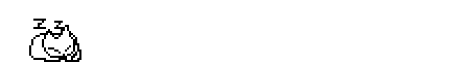

<div align="center">
  <br />
    
  <h1>Oneko</h1>
  <p>A tiny pixel cat for your website. React, Svelte, Vue, Solid, one script tag, or every site in Chrome.</p>
  <p>
    <a href="https://oneko.dhrv.pw">Playground</a>
    ·
    <a href="https://oneko.dhrv.pw/studio">Studio</a>
    ·
    <a href="https://oneko.dhrv.pw/docs">Documentation</a>
  </p>
  <p>
    <a href="https://github.com/0xdhrv/oneko/stargazers"></a>
    <a href="https://github.com/0xdhrv/oneko/blob/main/LICENSE"></a>
    <a href="https://github.com/0xdhrv/oneko/commits"></a>
    <a href="https://buymeacoffee.com/0xdhrv"></a>
  </p>
  <br />
</div>

Oneko follows the pointer, naps when things are quiet, and shares cat-themed thoughts. It comes
with 24 pixel-art coats, optional sounds, keep-out zones, and a studio for designing your own cat.

- **A parade of cats:** mount several and set `chase="cat"` so each follows the one before it.
- **Page reactions:** `napWhileTyping`, `followFocus`, and `perchOnHover`.
- **Visitor controls:** a remembered hide toggle (`setCatsHidden` or `data-oneko-toggle`) and a
  keyboard-reachable `pettable` cat.
- **Play:** `grabbable` cats can be tossed, `treats` turns a double-click into a fish, and
  `data-oneko-knockable` and `data-oneko-box` give resting cats something to knock over or sit in.
- **Tour cat:** `goTo`, `say`, `sit`, and `follow` from a React ref, `createOneko`, or
  `<oneko-cat>`, plus `data-oneko-say` comments and `onPet`, `onCatchCursor`, `onSleep`,
  `onToss`, and `onTreat` events.
- **Seasons and moods:** a holiday hat around Halloween, the winter holidays, and New Year
  (`seasonal={false}` to opt out), cat hours with `timeOfDay`, and greetings for returning
  visitors with `affection`.
- **Hosted coats:** wear any 256 × 128 sprite sheet by URL, and share it with
  `/studio?sprite=https://…`.

## React

Install the [shadcn registry](https://ui.shadcn.com/docs/registry) item. You get the source, so
the code is yours to change.

```bash
npx shadcn@latest add https://oneko.dhrv.pw/r/oneko.json
```

Render one `Oneko` from a client component. It mounts itself on `document.body`.

```tsx
"use client";

import Oneko from "@/components/oneko";

export function CatLayer() {
  return <Oneko skin="calico" bubbleText="treat inspection in progress" />;
}
```

In Next.js App Router, load it with `dynamic(..., { ssr: false })` from a client wrapper. See the
[installation guide](https://oneko.dhrv.pw/docs#installation).

Named skins load in one chunk the first time one is used. For the classic coat only (plus custom
sprites), install `https://oneko.dhrv.pw/r/oneko-classic.json` instead.

## Svelte, Vue, and Solid

Download the component into your project. It takes the same props as the React component.

```bash
curl -o src/lib/Oneko.svelte https://oneko.dhrv.pw/frameworks/Oneko.svelte
```

```svelte
<script>
  import Oneko from "$lib/Oneko.svelte";
</script>

<Oneko skin="calico" meow />
```

```bash
curl -o src/components/Oneko.vue https://oneko.dhrv.pw/frameworks/Oneko.vue
```

```vue
<script setup>
import Oneko from "./components/Oneko.vue";
</script>

<template>
  <Oneko skin="calico" :speed="12" meow @state-change="console.log" />
</template>
```

```bash
curl -o src/components/Oneko.tsx https://oneko.dhrv.pw/frameworks/Oneko.solid.tsx
```

```tsx
import Oneko from "./components/Oneko";

export default function App() {
  return <Oneko skin="calico" meow onStateChange={console.log} />;
}
```

Each loads the engine from the hosted build in the browser, so SvelteKit, Nuxt, and SolidStart
can render them during SSR. See the [framework guide](https://oneko.dhrv.pw/docs#frameworks).

## npm

To bundle the engine and coats instead of loading them from oneko.dhrv.pw, install the package.

```bash
npm install oneko
```

```tsx
import Oneko from "oneko"; // React
import Oneko from "oneko/vue";
import Oneko from "oneko/svelte";
import Oneko from "oneko/solid";
import { createOneko } from "oneko/vanilla";
```

See the [package README](packages/oneko/README.md) for sounds and SSR notes.

## Any other site

Astro, Hugo, WordPress, or plain HTML can use one script tag. Options are `data-` attributes named
after the props.

```html
<script type="module" src="https://oneko.dhrv.pw/oneko.js" data-skin="calico" data-meow></script>
```

You can also use a `<oneko-cat>` element, which fires `statechange` events and works in Angular,
Lit, and other frameworks, or the `createOneko()` API. See
[Without React](https://oneko.dhrv.pw/docs#html).

## Chrome extension

The [extension](extension/README.md) puts the cat on every site you visit, with a toolbar popup
for the coat, size, sounds, and a per-site switch.

## Documentation

The [documentation](https://oneko.dhrv.pw/docs) covers every prop, skins, zones, sounds, events,
and the studio. Agents can read the [Markdown version](https://oneko.dhrv.pw/docs.md) or
[llms.txt](https://oneko.dhrv.pw/llms.txt).

## Development

```bash
pnpm install
pnpm dev
```

```bash
pnpm lint
pnpm fmt:check
pnpm test
pnpm test:browser
pnpm build
```

`pnpm build` regenerates the registry and `public/oneko.js` before building the site.
`pnpm build:package` builds the npm package in `packages/oneko/dist`, and `pnpm build:extension`
builds the Chrome extension and its Web Store zip in `dist/`. To deploy
to Cloudflare Workers, run `pnpm preview` locally, then `pnpm deploy`. See the
[development notes](docs/development.md) for details.

| Path                      | Purpose                                     |
| ------------------------- | ------------------------------------------- |
| `components/oneko.tsx`    | Installable React component.                |
| `hooks/` and `lib/oneko/` | Animation hook and engine.                  |
| `lib/oneko/vanilla*.ts`   | Framework-free build served as `/oneko.js`. |
| `public/frameworks/`      | Svelte and Vue components.                  |
| `packages/oneko/`         | npm package and its framework entries.      |
| `extension/`              | Chrome extension.                           |
| `registry.json`           | Source manifest for the shadcn registry.    |
| `app/`                    | Playground, studio, and documentation.      |

## Credits

Oneko is inspired by [adryd325/oneko.js](https://github.com/adryd325/oneko.js) and the skin gallery
in [oneko-swift](https://github.com/oneko-swift/oneko-swift). The sprite artwork belongs to its
original creators; see [skin credits](docs/skins.md).

Code is available under the [MIT License](LICENSE).
